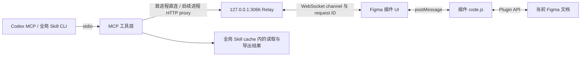

# 架构与数据流

## 模块职责

| 路径 | 职责 |
| --- | --- |
| `src/server.ts` | 创建 MCP server、注册各组工具与提示、启动 relay 和 stdio；`--relay-only` 仅启动本机桥接 |
| `src/relay.ts` | WebSocket 连接、文件注册、会话目标、请求相关性、超时和 HTTP proxy |
| `src/protocol.ts` | 插件命令、进度和操作回执类型 |
| `src/design.ts` | 读取选项与共享 schema；节点序列化由插件单一实现 |
| `src/exports.ts` | 安全文件名、导出目录、图像落盘及倍率算法 |
| `src/tools/register.ts` | 固定每次操作的文件身份，统一 MCP 失败标记，保留部分结果 |
| `src/tools/read.ts` | 内容读取工具注册 |
| `src/tools/write.ts` | 节点、文本、布局、组件、变量等设计操作 |
| `src/tools/export.ts` | 单节点导出与资源批量导出 |
| `src/tools/files.ts` | 发现连接和明确选择文件 |
| `src/tools/prompts.ts` | 6个可选策略提示，与实际工具分开 |
| `src/logger.ts` | 日志只写 stderr，避免破坏 stdio 协议 |
| `figma-plugin/ui.html` | WebSocket、重连、命令转发、状态和进度 UI |
| `figma-plugin/code.js` | Figma 沙箱中的命令分发与真实文档操作 |
| `scripts/build.mjs` | 类型检查、esbuild 打包及输入/产物摘要 |
| `tests/` | 插件读取、倍率/缓存隔离与真实本机协议的替身测试 |

## 文件和会话路由

插件每次运行生成独立通道，在同次运行的重连中保持；同名或中文文件不会共享同一个通道。`fileKey` 不是连接前提。普通插件无法假定拥有该字段，见 [Figma Plugin API](https://developers.figma.com/docs/plugins/api/figma/)。

每个 MCP 进程有独立 session ID。明确选择的通道只属于该会话；多文件下未选择的会话拒绝执行。空关键字、歧义和未匹配选择都会使当前会话解除目标，须成功明确选择后继续。已选文件断开后保留绑定，不自动切到另一个文件；重连相同通道或重新明确选择后继续。

单次工具调用用异步上下文固定文件身份；期间切换会话目标不会改变该调用的后续命令及导出目录。明确的目标通道会一同传给代理所有者。

每条命令生成 request ID，登记超时与目标 socket。只有原 socket 的回执能完成请求；`false`、`0`、`null` 也是合法结果。断连立即结束该连接的等待请求。进度更新不延长绝对截止时间，确保 MCP、代理与 relay 不出现相互矛盾的超时。同一通道的新连接替换旧连接时，旧 socket 关闭不能删除新注册。

relay 只监听 IPv4 loopback。HTTP接口只供本机进程，拒绝带浏览器 Origin 的请求；Figma插件仍走WebSocket。端口占用时先核对 `/health` 的服务名及协议版本，只有协议及构建摘要一致的 Figma relay 才能共享；其他占用让启动失败。

## 一次读取

1. `get_connected_files` / `/channels` 发现连接；明确 session 的目标。
2. MCP 工具校验参数，调用 relay 的 `sendCommandToFigma`。
3. Relay 发送 `{type: "broadcast", message: {id, command, params}}`。
4. UI 将命令转发给沙箱；`handleCommand` 调用 Plugin API。
5. UI 用相同 ID 返回结果/错误；relay 匹配等待请求；MCP 返回结构化结果。

页面索引会加载全部页面；详细读取使用最小必要范围。隐藏节点及隐藏祖先分支被排除，深度默认不限制；`maxDepth` 会使读取显式截断。组件变体从所属组件集读取属性定义，并返回 `componentPropertyDefinitionsSourceId`，避免直接访问变体 getter 中断整页读取。依据为 [Figma 组件属性定义 API](https://developers.figma.com/docs/plugins/api/ComponentNode/#componentpropertydefinitions)。

设计源数据不是需求生效状态判据，灰色文案不能一律解释成删除。

## 一次写入或导出

写入先读取目标和所需旧值，再执行用户要求的精确操作，然后重读节点与相关消费者。错误或超时可能发生在部分修改之后；不盲目重试创建、转换或批量操作。需要恢复时按已记录的具体 ID 和旧值处理。

创建和修改节点的成功回执保留 JSON 数据与节点 ID；批量操作另保留进度与失败项。创建文本等待字体和内容写入完成，字体失败清理新节点；RGBA 的 alpha 为0时保留透明度，字号保留小数。

导出是本地文件输出。源文件身份进入导出目录，避免不同文件的相同节点 ID 或文件名互相覆盖。Web PNG 倍率按画布尺寸降低，包含大画板小于1倍的情况；Android 批量模式仍固定4倍。实现倍率、目录和结果以真实回执为准，不把设计坐标当作屏幕像素或 Android dp。

## 错误与只读语义

统一注册层将异常、`success:false`、部分失败计数和缺失导出ID标成 `isError:true`，保留成功节点、失败节点和错误明细。CLI 以 `FAIL` 返回工具失败，以 `UNKNOWN` 返回连接或协议不确定性；缓存保存失败单独报告 `cacheError` 并保留已完成操作的回执。

扫描文字、读取交互均不触碰 fills、strokes 或其他设计属性；交互保留 `CHANGE_TO`。文本写入先加载原有全部字体，不替换混合字体为首个字体，也不静默回退字体。

构建先通过类型检查，再生成JS与 `dist/build.json`；打包运行副本时同时核对源输入及实际产物摘要。声明文件及服务端重复节点过滤实现已移除。
